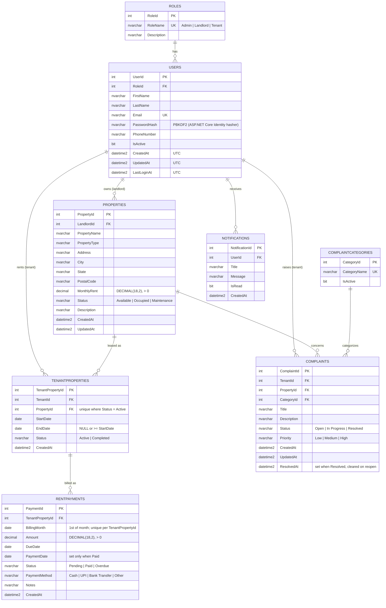

# RentEase — Entity Relationship Diagram

Eight tables. Created by `01_RentEaseDb_Setup.sql`; existing databases are brought up to date by
`02_RentEaseDb_Upgrade.sql`.

## Integrity rules enforced by the database

| Rule | Constraint |
|---|---|
| Email is unique | `UQ_Users_Email` |
| One active tenant per property | `UX_TenantProperties_ActiveProperty` (filtered unique index) |
| Rental end date not before start date | `CK_TenantProperties_Dates` |
| One rent record per rental per month | `UQ_RentPayments_TenantProperty_BillingMonth` |
| Billing month is the 1st of a month | `CK_RentPayments_BillingMonth` |
| Money is positive | `CK_Properties_MonthlyRent`, `CK_RentPayments_Amount` |
| Paid records have a payment date and method; unpaid ones have no payment date | `CK_RentPayments_PaidDetails` |
| Allowed status / priority / method values | `CK_*_Status`, `CK_Complaints_Priority`, `CK_RentPayments_PaymentMethod` |
| No cascading deletes | every foreign key is `NO ACTION`; history can't be removed by deleting a parent |

## Rules enforced by the API (not expressible as constraints)

- A property is `Occupied` exactly while it has an `Active` rental (assigning/ending a rental updates both in one transaction).
- A tenant has at most one active rental.
- An unpaid rent record whose due date has passed is `Overdue`; paid records are never overdue.
- Complaints can only be raised by the tenant currently renting the property.
